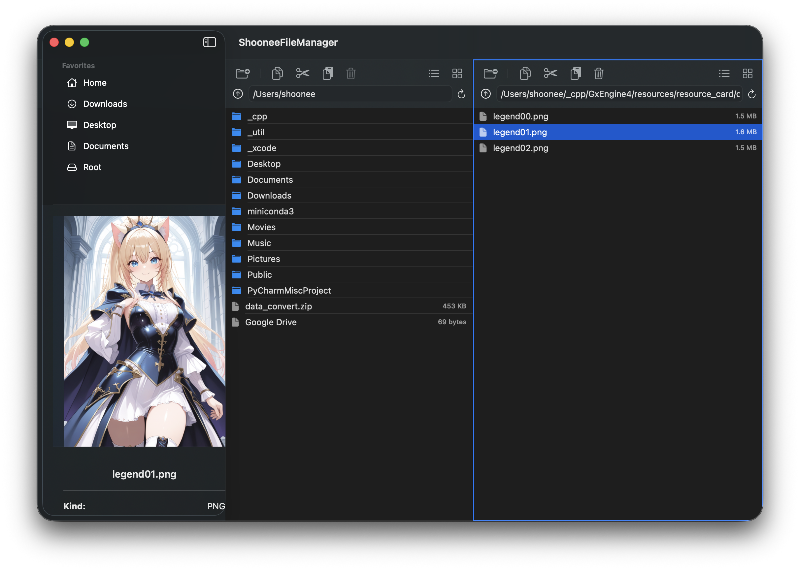

# ShooneeFileManager

A dual-pane file manager for macOS built with SwiftUI and AppKit.

## Overview

ShooneeFileManager is a lightweight Finder-style file manager with a two-pane workflow.
It focuses on fast navigation, keyboard-driven file operations, and a built-in preview area.

## Features

- Dual-pane layout for moving and comparing files side by side
- Editable favorites: add with `+`, by dragging a folder in, or from the context menu; reorder and remove freely
- Locations sidebar with mounted network drives and external disks, plus "Connect to Server" for `smb://` addresses
- Network favorites reconnect when you open them
- Name, date, and size columns with sorting, and real file type icons
- Back, forward, and up navigation
- Search within the current folder and a hidden files toggle
- Lists refresh automatically when files change
- File preview panel with thumbnail and metadata
- Copy, cut, paste, rename, move to trash, and create folder actions
- Conflict handling with replace, skip, and cancel, plus transfer status with cancel
- Drag and drop between panes, onto folders, and to or from Finder
- Context menu and keyboard shortcuts for common actions

## Keyboard Shortcuts

| Key | Action |
| --- | --- |
| `Return` | Open the selected item |
| `Delete` | Move to trash (with confirmation) |
| `F2` | Rename |
| `Left` / `Right` | Switch panes |
| `Cmd+C` / `Cmd+X` / `Cmd+V` | Copy, cut, paste |
| `Cmd+N` | New folder |
| `Cmd+[` / `Cmd+]` | Back, forward |
| `Cmd+Shift+.` | Show hidden files |

## Built With

- Swift
- SwiftUI
- AppKit
- Quick Look Thumbnailing

## Running Locally

1. Open `ShooneeFileManager.xcodeproj` in Xcode.
2. Select your own team under Signing & Capabilities. A free Apple ID personal team is enough.
3. Build and run the `ShooneeFileManager` target.

Run the tests with `Cmd+U`. They only use temporary folders and a private pasteboard.

## Permissions

macOS tracks privacy permissions by code signature, so the app must be signed with a stable identity. With an ad-hoc signature, every rebuild counts as a new app and permissions are lost.

The app is not sandboxed. Grant Full Disk Access once in System Settings > Privacy & Security, and it can open protected folders without asking for each one. The app shows a banner with shortcuts until access is granted.

## Current Status

This project is actively being improved. Transfer status is per item, so cancelling stops after the current item finishes. Changes made on a server from another machine may not refresh automatically in network folders.

## Screenshot

The repository includes the main app screenshot here:

- [`screenshot.png`](./screenshot.png)
